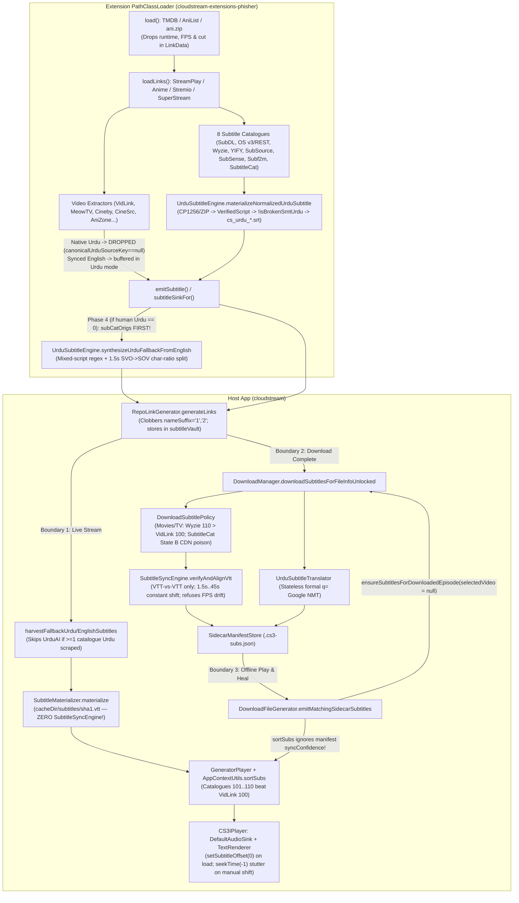

# End-to-End Subtitle Harvesting, Provenance, Audio Sync & Urdu Bol-Chal Architecture

## Overview

Across `cloudstream-extensions-phisher` (`StreamPlay`, `StreamPlayAnime`, `StreamPlayStremioCatelog`, `SuperStream`) and the sibling host app `cloudstream` (`RepoLinkGenerator`, `SubtitleMaterializer`, `CS3IPlayer`, `DownloadSubtitlePolicy`, `SubtitleSyncEngine`, `FallbackSubtitleHarvester`, `UrduSubtitleTranslator`, `DownloadFileGenerator`, `DownloadManager`), subtitles and video streams travel through **two decoupled pipelines separated by an Android `PathClassLoader` boundary**. When a user plays or downloads a title, the extension's `loadLinks()` fans out video extractors and up to 8 subtitle catalogues concurrently into `callback(ExtractorLink)` and `subtitleCallback(SubtitleFile)` — with **zero visibility** into which video mirror, container duration, or framerate (`23.976` vs `24` vs `25` FPS) the host will ultimately select. Conversely, the host owns stream selection, Media3/FFmpeg audio decoding (`CS3IPlayer`), download persistence (`DownloadManager` + `SidecarManifestStore`), and track ranking (`DownloadSubtitlePolicy` + `AppContextUtils.sortSubs`), plus its own mirror copy of catalogue scrapers (`FallbackSubtitleHarvester`) and Google Translate NMT (`UrduSubtitleTranslator`).

Today, three structural inversions across that boundary cause chronic subtitle desynchronization and stiff, unnatural Urdu output:
1. **Provenance Priority Inversion**: Both the extension's Phase 4 neural donor queue ([UrduSubtitleEngine.kt:2568-2587](/home/mahmood/.t3/worktrees/cloudstream-extensions-phisher/feat-urdu-bolchal-audio-999f345cb2d84bbf/StreamPlay/src/main/kotlin/com/Phisher98/UrduSubtitleEngine.kt:2568)) and the host's Movie/TV comparator ([DownloadSubtitlePolicy.kt:68-96, 1080-1085](/home/mahmood/.t3/worktrees/cloudstream/urdu-bolchal-audio-sync-17/app/src/main/java/com/lagradost/cloudstream3/utils/downloader/DownloadSubtitlePolicy.kt:68)) rank generic text catalogues (`Wyzie = 110`, `SubtitleAPI = 105`, `OpenSubtitles/Stremio/SubDL = 104`, `SubtitleCat = 102`) **above** the frame-locked sidecars shipped by the video stream itself (`VidLink = 100`, `MeowTV = 98`, `Cineby = 95`, `CineSrc = 94`), while `canonicalUrduSourceKey` ([UrduSubtitleEngine.kt:169-185](/home/mahmood/.t3/worktrees/cloudstream-extensions-phisher/feat-urdu-bolchal-audio-999f345cb2d84bbf/StreamPlay/src/main/kotlin/com/Phisher98/UrduSubtitleEngine.kt:169)) unconditionally drops 100% of native Urdu sidecars emitted by video providers.
2. **State-Boundary Timing Blindness**: Zero timing verification runs during live streaming (`SubtitleSyncEngine` is never called by `RepoLinkGenerator`, `SubtitleMaterializer`, or `CS3IPlayer`, and `GeneratorPlayer.loadLink` resets `setSubtitleOffset(0)` at [GeneratorPlayer.kt:997](/home/mahmood/.t3/worktrees/cloudstream/urdu-bolchal-audio-sync-17/app/src/main/java/com/lagradost/cloudstream3/ui/player/GeneratorPlayer.kt:997)). During downloads, `SubtitleSyncEngine.verifyAndAlignVtt` ([SubtitleSyncAndManifest.kt:176-318](/home/mahmood/.t3/worktrees/cloudstream/urdu-bolchal-audio-sync-17/app/src/main/java/com/lagradost/cloudstream3/utils/downloader/SubtitleSyncAndManifest.kt:176)) aligns only against an English VTT anchor (never audio), blocks shifts `< 1.5s` and `> 45s`, refuses linear FPS drift (`hasStableHalfOffsets`), and writes rejected `65s`-desynced files to disk — where offline playback (`AppContextUtils.sortSubs`, [AppContextUtils.kt:369-390](/home/mahmood/.t3/worktrees/cloudstream/urdu-bolchal-audio-sync-17/app/src/main/java/com/lagradost/cloudstream3/utils/AppContextUtils.kt:369)) ignores `SidecarManifestStore` sync scores and auto-selects them first.
3. **MT-Dump Admission & Stateless *Kitabi* Translation**: Post-2016 Google Translate/NMT dumps on SubDL, OpenSubtitles, YIFY, and SubtitleCat contain clean Urdu Unicode with zero ASCII English words, passing `containsVerifiedUrduScript` ([UrduSubtitleEngine.kt:2290](/home/mahmood/.t3/worktrees/cloudstream-extensions-phisher/feat-urdu-bolchal-audio-999f345cb2d84bbf/StreamPlay/src/main/kotlin/com/Phisher98/UrduSubtitleEngine.kt:2290)) and `!isBrokenSmtUrdu` ([UrduSubtitleEngine.kt:1321](/home/mahmood/.t3/worktrees/cloudstream-extensions-phisher/feat-urdu-bolchal-audio-999f345cb2d84bbf/StreamPlay/src/main/kotlin/com/Phisher98/UrduSubtitleEngine.kt:1321)) as "Tier-1 Human" tracks (blocking neural translation of synced English sidecars). When neural translation does run, the extension splices Urdu Nastaliq mid-sentence before `sl=en` ([UrduSubtitleEngine.kt:1244-1273](/home/mahmood/.t3/worktrees/cloudstream-extensions-phisher/feat-urdu-bolchal-audio-999f345cb2d84bbf/StreamPlay/src/main/kotlin/com/Phisher98/UrduSubtitleEngine.kt:1244)) and slices merged SVO->SOV sentences by English character ratio ([UrduSubtitleEngine.kt:1677](/home/mahmood/.t3/worktrees/cloudstream-extensions-phisher/feat-urdu-bolchal-audio-999f345cb2d84bbf/StreamPlay/src/main/kotlin/com/Phisher98/UrduSubtitleEngine.kt:1677), spoiling plot reveals early), while the host's `UrduSubtitleTranslator` ([UrduSubtitleTranslator.kt:542-549](/home/mahmood/.t3/worktrees/cloudstream/urdu-bolchal-audio-sync-17/app/src/main/java/com/lagradost/cloudstream3/utils/downloader/UrduSubtitleTranslator.kt:542)) sends isolated, formal *kitabi* `q=` cues with zero idiom adaptation or scene memory.

---

## Key Concepts

- **Cross-Classloader Mode & Callback Protocol**:
  - `SubtitleModeManager.setMode` ([SubtitleModeManager.kt:88-124](/home/mahmood/.t3/worktrees/cloudstream/urdu-bolchal-audio-sync-17/app/src/main/java/com/lagradost/cloudstream3/subtitles/SubtitleModeManager.kt:88)) and `UrduSubtitleEngine.setSubtitleMode` ([UrduSubtitleEngine.kt:325-372](/home/mahmood/.t3/worktrees/cloudstream-extensions-phisher/feat-urdu-bolchal-audio-999f345cb2d84bbf/StreamPlay/src/main/kotlin/com/Phisher98/UrduSubtitleEngine.kt:325)) synchronize `"default"` (English) vs `"urdu"` in 0ms across plugin classloaders via `System.setProperty("cloudstream.subtitle.mode", mode.id)` backed by SharedPreferences `"cloudstream_subtitle_mode_prefs"` and `"subtitles_auto_select"`.
  - For downloads and heals (`emitAllSubtitleLanguages = true`), `RepoLinkGenerator` wraps `subtitleCallback` in `BilingualDownloadSubtitleCallback` (`toString() == "cloudstream.bilingual_download_subtitles=true"`, [RepoLinkGenerator.kt:64-80, 389-393](/home/mahmood/.t3/worktrees/cloudstream/urdu-bolchal-audio-sync-17/app/src/main/java/com/lagradost/cloudstream3/ui/player/RepoLinkGenerator.kt:64)). **Broken contract**: none of the four extension surfaces inspect `subtitleCallback`, so extensions remain mode-locked during downloads.
- **Provenance Header & Static Priority Ladder (`X-StreamPlay-Source`)**:
  - Extensions stamp `headers["X-StreamPlay-Source"]` on emitted `SubtitleFile`s ([StreamPlay.kt:1290](/home/mahmood/.t3/worktrees/cloudstream-extensions-phisher/feat-urdu-bolchal-audio-999f345cb2d84bbf/StreamPlay/src/main/kotlin/com/Phisher98/StreamPlay.kt:1290)); host `StreamPlayDynamicBridge.wrapSubtitleCallback` ([StreamPlayDynamicBridge.kt:1347](/home/mahmood/.t3/worktrees/cloudstream/urdu-bolchal-audio-sync-17/app/src/main/java/com/lagradost/cloudstream3/utils/downloader/StreamPlayDynamicBridge.kt:1347)) and `FallbackSubtitleHarvester` do the same.
  - `DownloadSubtitlePolicy.SOURCE_MARKERS` ([DownloadSubtitlePolicy.kt:68-96](/home/mahmood/.t3/worktrees/cloudstream/urdu-bolchal-audio-sync-17/app/src/main/java/com/lagradost/cloudstream3/utils/downloader/DownloadSubtitlePolicy.kt:68)) maps markers to static ints: generic catalogues `101..110` (`wyzie=110`, `subtitleapi=105`, `opensubtitles/stremio/subdl=104`, `addic7ed/yify/subsource/subsense=103`, `subtitlecat/watchsomuch=102`, `subf2m=101`), video stream providers `87..100` (`vidlink=100`, `meowtv=98`, `cineby=95`, `cinesrc=94`, `vidfast=93`, `megaplay=92`, `vidrift=91`, `animepahe=90`, `anizone=89`, `zokoanime/kickassanime=88`, `animex=87`), `urdu-neural-fallback` (`UrduAI`) `80`, unknown hosts `0`, banned sources `-100`. Only `ANIME_NATIVE_SOURCE_PRIORITIES` (`:127-137`) elevates anime stream providers (`113..130`) above `wyzie` (`110`).
- **Dual Subtitle Materializers (`.srt` in Extension vs `.vtt` in Host)**:
  - Extension `UrduSubtitleEngine.materializeNormalizedUrduSubtitle` ([UrduSubtitleEngine.kt:2423-2525](/home/mahmood/.t3/worktrees/cloudstream-extensions-phisher/feat-urdu-bolchal-audio-999f345cb2d84bbf/StreamPlay/src/main/kotlin/com/Phisher98/UrduSubtitleEngine.kt:2423)) inflates ZIP/GZIP, decodes CP1256/UTF-16, normalizes Arabic presentation forms, checks `containsVerifiedUrduScript` + `!isBrokenSmtUrdu`, wraps lines in `\u200F` (Unicode RLM), and writes UTF-8-BOM `file:///.../cache/cs_urdu_cas_<sha256_24>.srt` (`MAX_DISK_CACHE_FILES = 64`, `16 MiB`, `7d` TTL at [UrduSubtitleEngine.kt:2139-2184](/home/mahmood/.t3/worktrees/cloudstream-extensions-phisher/feat-urdu-bolchal-audio-999f345cb2d84bbf/StreamPlay/src/main/kotlin/com/Phisher98/UrduSubtitleEngine.kt:2139)).
  - Host `SubtitleMaterializer.materialize` ([SubtitleMaterializer.kt:79, 222-340](/home/mahmood/.t3/worktrees/cloudstream/urdu-bolchal-audio-sync-17/app/src/main/java/com/lagradost/cloudstream3/subtitles/SubtitleMaterializer.kt:222)) fetches remote HTTP or extension `file://` payloads (`8 MiB` cap), runs `SubtitleBytesDecoder.decode` ([SubtitleTextFormat.kt:40-96](/home/mahmood/.t3/worktrees/cloudstream/urdu-bolchal-audio-sync-17/app/src/main/java/com/lagradost/cloudstream3/subtitles/SubtitleTextFormat.kt:40)) and `SubtitleTextTranscoder.toWebVtt` (`:412-436`, SRT/VTT/ASS/TTML/SAMI/MicroDVD -> WebVTT + `\u200F`), and atomically publishes `context.cacheDir/subtitles/<sha1>.vtt` (`MAX_CACHE_FILES = 400`).
- **Sidecar Manifest (`SidecarManifestStore`)**:
  - Persists `<videoBase>.cs3-subs.json` alongside downloaded videos ([SubtitleSyncAndManifest.kt:505-661](/home/mahmood/.t3/worktrees/cloudstream/urdu-bolchal-audio-sync-17/app/src/main/java/com/lagradost/cloudstream3/utils/downloader/SubtitleSyncAndManifest.kt:505)), storing `videoDurationMs`, `videoFileSize`, `videoReleaseHint` (**not** `videoProviderKey`), and per-sidecar `SidecarManifestEntry` (`providerKey`, `sourceLabel`, `isTranslated`, `syncConfidence`, `appliedOffsetMs`, `qeScore`, `timingSha256`).
- **Audio & Subtitle Renderer Stack (`CS3IPlayer`)**:
  - Runs Media3 `1.9.3` + `nextlib-media3ext` `1.9.3-0.12.0` (`libavcodec.so` decoding 18 audio codecs in software, [libs.versions.toml:34-37](/home/mahmood/.t3/worktrees/cloudstream/urdu-bolchal-audio-sync-17/gradle/libs.versions.toml:34)). `FixedNextRenderersFactory` ([FixedNextRenderersFactory.kt:12-28](/home/mahmood/.t3/worktrees/cloudstream/urdu-bolchal-audio-sync-17/app/src/main/java/com/lagradost/cloudstream3/ui/player/FixedNextRenderersFactory.kt:12)) shares one `DefaultAudioSink` across `MediaCodecAudioRenderer` and `FfmpegAudioRenderer`, while `CS3IPlayer` ([CS3IPlayer.kt:1880-1892](/home/mahmood/.t3/worktrees/cloudstream/urdu-bolchal-audio-sync-17/app/src/main/java/com/lagradost/cloudstream3/ui/player/CS3IPlayer.kt:1880)) mounts `TextRenderer` (`experimentalSetLegacyDecodingEnabled(true)`) over `CustomSubtitleDecoderFactory` -> `DelegatingSubtitleDecoder`.

---

## How It Works



### 1. Extension Harvesting, Phase 1–5 Ordering & Fork Divergences (`cloudstream-extensions-phisher`)

#### Metadata Drop & Season-Year Bug (`load()` -> `LinkData` -> `loadLinks()`)
Every extension surface fetches runtime metadata in `load()` solely for UI display and **drops 100% of runtime, framerate, and release-cut metadata** before serializing `LinkData` into `loadLinks()`:
- **`StreamPlay`**: `load()` parses TMDB `MediaDetail.runtime` ([StreamPlay.kt:980, 2003](/home/mahmood/.t3/worktrees/cloudstream-extensions-phisher/feat-urdu-bolchal-audio-999f345cb2d84bbf/StreamPlay/src/main/kotlin/com/Phisher98/StreamPlay.kt:980)) and `Episodes.runTime` (`:656, :1943`), but `StreamPlay.LinkData` ([StreamPlay.kt:1850-1879](/home/mahmood/.t3/worktrees/cloudstream-extensions-phisher/feat-urdu-bolchal-audio-999f345cb2d84bbf/StreamPlay/src/main/kotlin/com/Phisher98/StreamPlay.kt:1850)) carries none of them, forcing `resolveDurationHintSeconds` ([StreamPlayExtractor.kt:6490-6498](/home/mahmood/.t3/worktrees/cloudstream-extensions-phisher/feat-urdu-bolchal-audio-999f345cb2d84bbf/StreamPlay/src/main/kotlin/com/Phisher98/StreamPlayExtractor.kt:6490)) to guess static durations (`1440s` anime, `2520s` TV, `6000s` movie). Worse, for TV episodes `StreamPlay.load` sets `LinkData.year = season.airDate` year and `LinkData.airedYear = res.firstAirDate` ([StreamPlay.kt:628-633](/home/mahmood/.t3/worktrees/cloudstream-extensions-phisher/feat-urdu-bolchal-audio-999f345cb2d84bbf/StreamPlay/src/main/kotlin/com/Phisher98/StreamPlay.kt:628)), yet `subdl` (`:1516`), `subsource` (`:1535`), `subf2m` (`:1572`), and `subtitlecat` (`:1458`) pass `year = res.year ?: res.airedYear`. Because `parseSubDlAutoSlug` ([UrduSubtitleEngine.kt:2728](/home/mahmood/.t3/worktrees/cloudstream-extensions-phisher/feat-urdu-bolchal-audio-999f345cb2d84bbf/StreamPlay/src/main/kotlin/com/Phisher98/UrduSubtitleEngine.kt:2728)) and `parseSubSourceSearchMovieId` (`:3348`) index TV series by **series premiere year** and reject `abs(year - expectedYear) > 1`, any Season 2+ airing $\ge 2$ years after debut fails title-slug lookup whenever IMDb lookup misses.
- **`StreamPlayAnime` & `SuperStream`**: `StreamPlayAnime.LinkData` ([StreamPlayAnime.kt:1184-1220](/home/mahmood/.t3/worktrees/cloudstream-extensions-phisher/feat-urdu-bolchal-audio-999f345cb2d84bbf/StreamPlay/src/main/kotlin/com/Phisher98/StreamPlayAnime.kt:1184)) drops `ani.zip` `epData?.runtime` (`:334`). `SuperStream.LinkData` ([SuperStream.kt:1057-1082](/home/mahmood/.t3/worktrees/cloudstream-extensions-phisher/feat-urdu-bolchal-audio-999f345cb2d84bbf/SuperStream/src/main/kotlin/com/phisher98/SuperStream.kt:1057)) drops `MediaDetail.runtime` (`:595`), and `SuperStreamExtractor` discards exact release filenames (`NF.WEB-DL`, `BluRay`) known inside `invokeExternalSource` ([SuperStreamExtractor.kt:317-335](/home/mahmood/.t3/worktrees/cloudstream-extensions-phisher/feat-urdu-bolchal-audio-999f345cb2d84bbf/SuperStream/src/main/kotlin/com/phisher98/SuperStreamExtractor.kt:317)) and `invokeSuperstreamFeb` (`:3071-3078`).

#### `emitSubtitle` & Phase 1–5 State Machine (Default vs Urdu Mode)
- **Default Mode (`!urduMode`)**: `StreamPlay.emitSubtitle` ([StreamPlay.kt:1226-1301](/home/mahmood/.t3/worktrees/cloudstream-extensions-phisher/feat-urdu-bolchal-audio-999f345cb2d84bbf/StreamPlay/src/main/kotlin/com/Phisher98/StreamPlay.kt:1226)), `StreamPlayAnime.subtitleSinkFor` ([StreamPlayAnime.kt:596-605](/home/mahmood/.t3/worktrees/cloudstream-extensions-phisher/feat-urdu-bolchal-audio-999f345cb2d84bbf/StreamPlay/src/main/kotlin/com/Phisher98/StreamPlayAnime.kt:596)), `StreamPlayStremioCatelog.trackedSubCallback` ([StreamPlayStremioCatelog.kt:218-284](/home/mahmood/.t3/worktrees/cloudstream-extensions-phisher/feat-urdu-bolchal-audio-999f345cb2d84bbf/StreamPlay/src/main/kotlin/com/Phisher98/StreamPlayStremioCatelog.kt:218)), and `SuperStream.trackedSubtitleCallback` ([SuperStream.kt:654-662](/home/mahmood/.t3/worktrees/cloudstream-extensions-phisher/feat-urdu-bolchal-audio-999f345cb2d84bbf/SuperStream/src/main/kotlin/com/phisher98/SuperStream.kt:654)) accept only English tracks, attach `X-StreamPlay-Source`, and run Phase 3 completion ([StreamPlay.kt:1744-1778](/home/mahmood/.t3/worktrees/cloudstream-extensions-phisher/feat-urdu-bolchal-audio-999f345cb2d84bbf/StreamPlay/src/main/kotlin/com/Phisher98/StreamPlay.kt:1744)) until 5 distinct English sources arrive (`10s` cap). Only `StreamPlay` uses `SubtitleSourceLedger` ([SubtitleSourceLedger.kt:16-95](/home/mahmood/.t3/worktrees/cloudstream-extensions-phisher/feat-urdu-bolchal-audio-999f345cb2d84bbf/StreamPlay/src/main/kotlin/com/Phisher98/SubtitleSourceLedger.kt:16), keyed by `lang|url`); the other three surfaces deduplicate by raw `url` set only.
- **Urdu Mode (`urduMode == true`)**:
  1. **Native Video-Provider Urdu Tracks Dropped**: Although `VidLink` (`StreamPlayExtractor.kt:4602`), `CineSrc` (`:5636`), `Cineby` (`:6186`), `VidFast` (`:7257`), `MeowTV` (`:7357`), `VidRift` (`:7994`), and FebBox (`SuperStreamExtractor.kt:364`) emit native Urdu tracks from the video's own CDN pack, `emitSubtitle` ([StreamPlay.kt:1237-1248](/home/mahmood/.t3/worktrees/cloudstream-extensions-phisher/feat-urdu-bolchal-audio-999f345cb2d84bbf/StreamPlay/src/main/kotlin/com/Phisher98/StreamPlay.kt:1237)) requires `canonicalUrduSourceKey(rawProvenance) != null` ([UrduSubtitleEngine.kt:169-185](/home/mahmood/.t3/worktrees/cloudstream-extensions-phisher/feat-urdu-bolchal-audio-999f345cb2d84bbf/StreamPlay/src/main/kotlin/com/Phisher98/UrduSubtitleEngine.kt:169)), which returns `null` for all video providers — discarding 100% of stream-native Urdu tracks.
  2. **English Sidecars Suppressed & Preempted by `SubtitleCat` in Phase 4**: All English tracks (including synced `VidLink`/`Cineby`/`AniZone` `.vtt`s) are withheld from `subtitleCallback` and queued in arrival order into `deferredNonUrduSubtitles` + `bestEnglishSubtitleUrls` ([StreamPlay.kt:1278, 1293](/home/mahmood/.t3/worktrees/cloudstream-extensions-phisher/feat-urdu-bolchal-audio-999f345cb2d84bbf/StreamPlay/src/main/kotlin/com/Phisher98/StreamPlay.kt:1278)). Phase 3 ([StreamPlay.kt:1781-1823](/home/mahmood/.t3/worktrees/cloudstream-extensions-phisher/feat-urdu-bolchal-audio-999f345cb2d84bbf/StreamPlay/src/main/kotlin/com/Phisher98/StreamPlay.kt:1781)) retries unfinished Urdu catalogue tasks for `4.5s` when `countVerifiedHumanUrduSources() < 2`. Phase 4 (`8s` cap, [StreamPlay.kt:1828](/home/mahmood/.t3/worktrees/cloudstream-extensions-phisher/feat-urdu-bolchal-audio-999f345cb2d84bbf/StreamPlay/src/main/kotlin/com/Phisher98/StreamPlay.kt:1828)) runs **only if `countVerifiedHumanUrduSources() == 0`**, calling `synthesizeUrduFallbackFromEnglish` ([UrduSubtitleEngine.kt:2568-2634](/home/mahmood/.t3/worktrees/cloudstream-extensions-phisher/feat-urdu-bolchal-audio-999f345cb2d84bbf/StreamPlay/src/main/kotlin/com/Phisher98/UrduSubtitleEngine.kt:2568)) — which places **`subCatOrigs` (`SubtitleCat` `-orig.srt`) FIRST (`:2569-2573`) ahead of `deferredNonUrduSubtitles` (`:2574-2579`)**, takes `.take(3)`, and **stops after translating 1 candidate (`:2634`)**. Even if `SubtitleCat` misses, fast ~200ms catalogue responses (`opensubtitles-v3`, `wyzie`) beat decrypted video-provider sidecars in the arrival queue. Phase 5 ([StreamPlay.kt:1306-1320](/home/mahmood/.t3/worktrees/cloudstream-extensions-phisher/feat-urdu-bolchal-audio-999f345cb2d84bbf/StreamPlay/src/main/kotlin/com/Phisher98/StreamPlay.kt:1306)) flushes `.take(2)` English tracks only if `urduSubtitleCount == 0`.
- **Anime Urdu-Mode Regressions**:
  - Default mode disables generic movie/TV catalogues on anime because TV-broadcast commercial/OP cuts desync against Japanese web-rips ([StreamPlay.kt:1350-1354](/home/mahmood/.t3/worktrees/cloudstream-extensions-phisher/feat-urdu-bolchal-audio-999f345cb2d84bbf/StreamPlay/src/main/kotlin/com/Phisher98/StreamPlay.kt:1350), [StreamPlayAnime.kt:758-763](/home/mahmood/.t3/worktrees/cloudstream-extensions-phisher/feat-urdu-bolchal-audio-999f345cb2d84bbf/StreamPlay/src/main/kotlin/com/Phisher98/StreamPlayAnime.kt:758)), yet `if (!res.isAnime || urduMode)` (`StreamPlay.kt:1376`) and `if (urduMode)` (`StreamPlayAnime.kt:784`) turn all 8 generic catalogues back **on**!
  - Worse, `StreamPlayAnime` bypasses `canUseTmdbProviders` (`:466`) at [StreamPlayAnime.kt:767-768](/home/mahmood/.t3/worktrees/cloudstream-extensions-phisher/feat-urdu-bolchal-audio-999f345cb2d84bbf/StreamPlay/src/main/kotlin/com/Phisher98/StreamPlayAnime.kt:767) (`val effectiveSubSeason = tmdbSeason ?: if (isMovie) null else 1`), querying **Season 1 Episode N** subtitles for any Cour 2/3/4 anime whose `tmdbSeason` is unverified while `effectiveImdbId` points to the root show! Meanwhile `EarlySatisfactionConfig` hardcodes `minSubtitles = 6` ([StreamPlayAnime.kt:510](/home/mahmood/.t3/worktrees/cloudstream-extensions-phisher/feat-urdu-bolchal-audio-999f345cb2d84bbf/StreamPlay/src/main/kotlin/com/Phisher98/StreamPlayAnime.kt:510)), stalling `StreamPlayAnime` up to `maxPipelineTimeoutMs = 18_000L` (`:518`) in Urdu mode.

#### Catalogue Harvester Blindness, Linguistic Gates & Fork Drift (`StreamPlay` vs `SuperStream`)
- **8 Urdu Catalogues Ignore Sync Metadata**: Zero of the 8 Urdu harvesters (`SubDL`, `OpenSubtitles` Stremio v3 + Legacy REST, `YIFY`, `SubSource`, `SubSense`, `Subf2m`, `Wyzie`, `SubtitleCat`) inspect framerate (`MovieFPS` in OpenSubtitles REST JSON is dropped by `OpenSubtitlesLegacySubtitle` at [StreamPlayParser.kt:102-129](/home/mahmood/.t3/worktrees/cloudstream-extensions-phisher/feat-urdu-bolchal-audio-999f345cb2d84bbf/StreamPlay/src/main/kotlin/com/Phisher98/StreamPlayParser.kt:102)), runtime (`MovieTimeMS`), or `WEB-DL` vs `BluRay`/`DVDRip` lineage, and `SubDL`/`SubSource`/`Subf2m`/`Wyzie`/`OS v3` fail to filter `hearingImpaired` (`WYZIESubtitle` at `StreamPlayParser.kt:87-94` drops `isHearingImpaired` and `release`). `scoreSubDlAuthorTier` ([UrduSubtitleEngine.kt:2836-2845](/home/mahmood/.t3/worktrees/cloudstream-extensions-phisher/feat-urdu-bolchal-audio-999f345cb2d84bbf/StreamPlay/src/main/kotlin/com/Phisher98/UrduSubtitleEngine.kt:2836)) penalizes known bulk-MT uploaders (`blackgold`, `akhaliq_655`, `saad.jan`) by `-40` instead of dropping them, admitting their MT dumps as "Verified Human" when alone.
- **Gates Pass 100% of Modern NMT Dumps**: `containsVerifiedUrduScript` ([UrduSubtitleEngine.kt:2290-2394](/home/mahmood/.t3/worktrees/cloudstream-extensions-phisher/feat-urdu-bolchal-audio-999f345cb2d84bbf/StreamPlay/src/main/kotlin/com/Phisher98/UrduSubtitleEngine.kt:2290)) checks only Urdu vs Persian/Arabic orthography, and `isBrokenSmtUrdu` (`:1321-1346`) checks only mid-Urdu lowercase ASCII words (`"کے ripping"`) + 7 hardcoded 2012 strings; `scoreUrduSubtitleNaturalness` (`:1354-1374`) is dead code outside multi-SRT ZIPs (`:917`).
- **Extension NMT Corruption, Twist Spoilers & 40% Silent Cue Drops**:
  1. `adaptEnglishForSpokenUrduTranslation` ([UrduSubtitleEngine.kt:1244-1273, 1376-1414](/home/mahmood/.t3/worktrees/cloudstream-extensions-phisher/feat-urdu-bolchal-audio-999f345cb2d84bbf/StreamPlay/src/main/kotlin/com/Phisher98/UrduSubtitleEngine.kt:1244)) runs 14 unanchored regexes that splice **Urdu Nastaliq script inside English sentences** (`"یا خدایا، آخر یہ کیا happened to him?"`) *before* sending `sl=en&tl=ur` to Google NMT (`SuperStreamExtractor.kt:2075-2109` rewrites to plain English instead and purges Hindi loanwords `بھگوان`->`خدا` at `:2191-2203`, whereas `SuperStream` has severe bugs in `Subf2m` missing TV episode checks at [SuperStreamExtractor.kt:976-984](/home/mahmood/.t3/worktrees/cloudstream-extensions-phisher/feat-urdu-bolchal-audio-999f345cb2d84bbf/SuperStream/src/main/kotlin/com/phisher98/SuperStreamExtractor.kt:976) and `SubtitleCat` accepting unrelated shows with matching `S02E05` at `:1172-1185`).
  2. `buildContextualTranslationUnits` + `splitTranslatedUrduProportionally` ([UrduSubtitleEngine.kt:1648-1732, 1773-1817](/home/mahmood/.t3/worktrees/cloudstream-extensions-phisher/feat-urdu-bolchal-audio-999f345cb2d84bbf/StreamPlay/src/main/kotlin/com/Phisher98/UrduSubtitleEngine.kt:1648)) merges 2–3 English SVO cues across gaps `<= 1,500ms` into one Urdu SOV sentence and slices by **English character ratio**, moving Cue 2's reveal object (`"...Captain Miller."`) into Cue 1 before the actor speaks and splitting inside Urdu compound verbs (`کر | رہا ہے`).
  3. In `translateEnglishSrtToUrdu` ([UrduSubtitleEngine.kt:1883-1910](/home/mahmood/.t3/worktrees/cloudstream-extensions-phisher/feat-urdu-bolchal-audio-999f345cb2d84bbf/StreamPlay/src/main/kotlin/com/Phisher98/UrduSubtitleEngine.kt:1883)), failed 50-unit retry sub-batches return `emptyList()`, and line `:1908` (`mergedCues.size < (cues.size * 6) / 10`) caches partial `.srt` files missing **up to 40% of the movie's dialogue** for 7 days!

---

### 2. Boundary 1 — Live Streaming (`RepoLinkGenerator` -> `SubtitleMaterializer` -> `CS3IPlayer`)

1. **Link & Vault Ingestion (`RepoLinkGenerator`)**:
   - `RepoLinkGenerator.generateLinks` ([RepoLinkGenerator.kt:215-541](/home/mahmood/.t3/worktrees/cloudstream/urdu-bolchal-audio-sync-17/app/src/main/java/com/lagradost/cloudstream3/ui/player/RepoLinkGenerator.kt:215)) converts incoming `SubtitleFile`s via `PlayerSubtitleHelper.getSubtitleData` ([PlayerSubtitleHelper.kt:64-97](/home/mahmood/.t3/worktrees/cloudstream/urdu-bolchal-audio-sync-17/app/src/main/java/com/lagradost/cloudstream3/ui/player/PlayerSubtitleHelper.kt:64)), **overwrites `nameSuffix = "$suffixCount"`** (`:380`, `:829` — destroying provider name clues on any subtitle lacking `X-StreamPlay-Source`), stores tracks in `subtitleVault` (`:86`), and emits mode-matching tracks (`SubtitleModeManager.matchesSubtitleMode`, [SubtitleModeManager.kt:188-206](/home/mahmood/.t3/worktrees/cloudstream/urdu-bolchal-audio-sync-17/app/src/main/java/com/lagradost/cloudstream3/subtitles/SubtitleModeManager.kt:188)) to `PlayerGeneratorViewModel.addSubtitles` ([PlayerGeneratorViewModel.kt:488-493](/home/mahmood/.t3/worktrees/cloudstream/urdu-bolchal-audio-sync-17/app/src/main/java/com/lagradost/cloudstream3/ui/player/PlayerGeneratorViewModel.kt:488)).
   - After `api.loadLinks` and `StreamPlayDynamicBridge.recoverLinksFromPlugin` (`:414-439`), `harvestFallbackUrduSubtitles` (`:612-762`) runs if `< 3` Urdu sources exist. If `FallbackSubtitleHarvester.harvestUrdu` returns **even 1** unaligned catalogue Urdu track (`emittedUrduCount > 0`, `:683`), host neural synthesis (`:683-755`) is **skipped completely** — even when a frame-synced `VidLink` English WebVTT is sitting in `subtitleVault`! When synthesis does run (`:693-701`), `selectDiverseSubtitleData(..., selectedVideo = null)` picks `Wyzie (110)` ahead of `VidLink (100)`. Live mode-switching in `GeneratorPlayer.onSubtitleModeChanged` -> `harvestOrSynthesizeLiveUrduSubtitle` ([GeneratorPlayer.kt:1639-1680, 1783-1900](/home/mahmood/.t3/worktrees/cloudstream/urdu-bolchal-audio-sync-17/app/src/main/java/com/lagradost/cloudstream3/ui/player/GeneratorPlayer.kt:1783)) repeats the exact same catalogue-first mistake.
2. **Materialization & Renderer Mounting (`SubtitleMaterializer` -> `CS3IPlayer`)**:
   - `GeneratorPlayer.selectSubtitle` (`:603-637`) / `autoSelectSubtitles` (`:2252-2291`) calls `SubtitleMaterializer.materialize` ([SubtitleMaterializer.kt:222-340](/home/mahmood/.t3/worktrees/cloudstream/urdu-bolchal-audio-sync-17/app/src/main/java/com/lagradost/cloudstream3/subtitles/SubtitleMaterializer.kt:222)), which transcodes cues to `cacheDir/subtitles/<sha1>.vtt` **with zero `SubtitleSyncEngine` alignment**, and mounts `SingleSampleMediaSource` inside `MergingMediaSource` ([CS3IPlayer.kt:2070-2177](/home/mahmood/.t3/worktrees/cloudstream/urdu-bolchal-audio-sync-17/app/src/main/java/com/lagradost/cloudstream3/ui/player/CS3IPlayer.kt:2070)). `PlayerSubtitleHelper.initSubtitles` ([PlayerSubtitleHelper.kt:238-259](/home/mahmood/.t3/worktrees/cloudstream/urdu-bolchal-audio-sync-17/app/src/main/java/com/lagradost/cloudstream3/ui/player/PlayerSubtitleHelper.kt:238)) configures Nastaliq/Naskh `Typeface` on `SubtitleView`.
   - `GeneratorPlayer.loadLink` ([GeneratorPlayer.kt:997](/home/mahmood/.t3/worktrees/cloudstream/urdu-bolchal-audio-sync-17/app/src/main/java/com/lagradost/cloudstream3/ui/player/GeneratorPlayer.kt:997)) resets `player.setSubtitleOffset(0)`. Worse, `CS3IPlayer.setSubtitleOffset` ([CS3IPlayer.kt:882-885](/home/mahmood/.t3/worktrees/cloudstream/urdu-bolchal-audio-sync-17/app/src/main/java/com/lagradost/cloudstream3/ui/player/CS3IPlayer.kt:882)) mutates `CustomDecoder.subtitleOffset` ([CustomSubtitleDecoderFactory.kt:247-346](/home/mahmood/.t3/worktrees/cloudstream/urdu-bolchal-audio-sync-17/app/src/main/java/com/lagradost/cloudstream3/ui/player/CustomSubtitleDecoderFactory.kt:247)) and calls `seekTime(-1)` (`exoPlayer.seekTo(currentPosition - 1)`), causing an audible/visible decoder flush while **failing** to re-parse an already-loaded `SingleSampleMediaSource` `.vtt` without a full `reloadPlayer`!
3. **ExoPlayer Audio Pipeline & Exact Live Lookahead Window (`CS3IPlayer`)**:
   - In [CS3IPlayer.kt:1778-1796](/home/mahmood/.t3/worktrees/cloudstream/urdu-bolchal-audio-sync-17/app/src/main/java/com/lagradost/cloudstream3/ui/player/CS3IPlayer.kt:1778), phones default to `FixedNextRenderersFactory(context)` (`MediaCodecAudioRenderer` + `FfmpegAudioRenderer` sharing one `DefaultAudioSink`), whereas **Android TV (`-1`) and HW-only (`1`) instantiate raw `DefaultRenderersFactory(context)`**!
   - Although `DefaultLoadControl` ([CS3IPlayer.kt:1906-1929](/home/mahmood/.t3/worktrees/cloudstream/urdu-bolchal-audio-sync-17/app/src/main/java/com/lagradost/cloudstream3/ui/player/CS3IPlayer.kt:1906)) buffers `50s` of *compressed* samples in `SampleQueue`, `DecoderAudioRenderer` halts decoding once `DefaultAudioSink`'s `AudioTrack` ring fills (`250ms–750ms` of PCM). Furthermore, Media3 `AudioProcessor.queueInput(ByteBuffer)` strips `presentationTimeUs`. Decorating `buildAudioSink` in **both** renderer factories with a `ForwardingAudioSink` yields exact microsecond `presentationTimeUs` on every `handleBuffer(buffer, presentationTimeUs, count)` (sampled only after `super.handleBuffer == true`, guarded by `Util.isEncodingLinearPcm(inputFormat.pcmEncoding)` so Android TV HDMI AC-3/E-AC-3 passthrough frames aren't misread as PCM).

---

### 3. Boundary 2 — Download Completion (`DownloadManager` -> `DownloadSubtitlePolicy` -> `SubtitleSyncEngine` -> `UrduSubtitleTranslator`)

1. **Bilingual Barrier & Detached Top-Up (`DownloadManager`)**:
   - When video bytes finish, `downloadSubtitlesForSuccessfulLink` ([DownloadManager.kt:13227-13245](/home/mahmood/.t3/worktrees/cloudstream/urdu-bolchal-audio-sync-17/app/src/main/java/com/lagradost/cloudstream3/utils/downloader/DownloadManager.kt:13227)) runs `downloadSubtitlesForFileInfoUnlocked` (`:10005-10809`) with `selectedVideo = link`, followed by detached `topUpSubtitlesAfterVideoComplete` (`:13255-13379`) to satisfy `bilingualDownloadLanguages() = listOf("en", "ur")` (`MAX_SUBTITLES_PER_LANGUAGE = 5` Movie/TV, `6` Anime; `MIN_URDU_SIDECARS = 6`, [DownloadSubtitlePolicy.kt:22-55](/home/mahmood/.t3/worktrees/cloudstream/urdu-bolchal-audio-sync-17/app/src/main/java/com/lagradost/cloudstream3/utils/downloader/DownloadSubtitlePolicy.kt:22)).
2. **Provenance Ranking Inversion & `SubtitleCat` Self-Poisoning**:
   - For Anime (`isAnimeSubtitleContext == true`, [DownloadSubtitlePolicy.kt:506-514](/home/mahmood/.t3/worktrees/cloudstream/urdu-bolchal-audio-sync-17/app/src/main/java/com/lagradost/cloudstream3/utils/downloader/DownloadSubtitlePolicy.kt:506)), `animeSubtitleSourcePriority` (`:127-137`) boosts `AniZone (130)`..`Cineby (113)` above `Wyzie (110)` and evicts generic English catalogues once $\ge 5$ anime-native tracks exist (`:657-660`).
   - **For Movies & TV (`animeContext == false`)**, `subtitleComparator` ([DownloadSubtitlePolicy.kt:1035-1096](/home/mahmood/.t3/worktrees/cloudstream/urdu-bolchal-audio-sync-17/app/src/main/java/com/lagradost/cloudstream3/utils/downloader/DownloadSubtitlePolicy.kt:1035)) sorts by `subtitleSourcePriority` (`:1080`) *before* `releaseAffinityPenalty(selectedVideo)` (`:1085`) and never boosts `selectedVideo`'s own provider — so `Wyzie (110)`..`Subf2m (101)` outrank `VidLink (100)`..`CineSrc (94)`.
   - Worse, `FallbackSubtitleHarvester.harvestSubtitleCatUrdu` ([FallbackSubtitleHarvester.kt:3094-3229](/home/mahmood/.t3/worktrees/cloudstream/urdu-bolchal-audio-sync-17/app/src/main/java/com/lagradost/cloudstream3/utils/downloader/FallbackSubtitleHarvester.kt:3094)) has a self-poisoning State B (`:3165-3226`): when no `-ur.srt` exists, it downloads SubtitleCat's unanchored `-orig.srt`, translates it via formal Google Translate (`UrduSubtitleTranslator.translateSrtToUrdu`), **POSTs that MT file to SubtitleCat's public CDN** (`publishToSubtitleCatCdn` -> `upload_subtitles.php`, [UrduSubtitleTranslator.kt:790-822](/home/mahmood/.t3/worktrees/cloudstream/urdu-bolchal-audio-sync-17/app/src/main/java/com/lagradost/cloudstream3/utils/downloader/UrduSubtitleTranslator.kt:790)), and emits it disguised as `X-StreamPlay-Source: subtitlecat` (**priority `102`**) instead of `UrduAI` (`80`)! Meanwhile, `FallbackSubtitleHarvester`'s Urdu parsers (`parseYify` `:1029`, `parseOpenSubtitlesLegacyUrdu` `:2250`, `parseStremioUrdu` `:1713`, `parseWyzieUrdu` `:1815`, `parseSubSourceUrdu` `:1982`, `parseSubf2mUrdu` `:2117`, `parseSubDlUrduPage` `:2424`, `parseSubSenseUrdu` `:2895`) omit the strict HI/SDH exclusions enforced on English (`:751, :919, :1029`).
3. **`SubtitleSyncEngine` Exact Math & Four Structural Sync Failures**:
   - `verifyAndAlignVtt` ([SubtitleSyncAndManifest.kt:176-318](/home/mahmood/.t3/worktrees/cloudstream/urdu-bolchal-audio-sync-17/app/src/main/java/com/lagradost/cloudstream3/utils/downloader/SubtitleSyncAndManifest.kt:176)) histograms pairwise onset `delta = a.startMs - c.startMs` across `±90,000ms` in `250ms` bins (`findBestConstantOffset`, `:324-371`), refines median residuals within `±1,500ms` (`:373-403`), and applies a **single scalar shift** `shiftVttTimestamps(vtt, bestOffsetMs)` (`:141-166`) iff:
     1. `abs(bestOffsetMs) in 1_500L..45_000L` (`:274`),
     2. `hasStableHalfOffsets` passes (`abs(earlyMedian - lateMedian) <= 2_500L` at `:422`), and
     3. `bestScore >= 0.45 && bestScore >= zeroScore + 0.18` (`onsetMatchF1` at `±1,500ms` tolerance, `:277, :426-450`).
   - Consequently, **all four real-world desync regimes fail**:
     - *Sub-1.5s lip-sync lag (`150..1,499ms`)*: Forbidden by `MIN_CONSTANT_SHIFT_MS = 1_500L` (`:34, :274`), and `OVERLAP_TOLERANCE_MS = 1_500L` (`:33`) scores a `1.4s`-lagged file near `1.0` at `0ms`, blocking `bestScore >= zeroScore + 0.18`.
     - *45–90s TV recaps / anime cold-opens (`45,001..90,000ms`)*: Found in the `±90s` search with high `bestScore` (`~0.85`), which **prevents `MISMATCH_REJECT`** (`bestScore < 0.06`, `:299`), while `:274` refuses shifts `> 45s` — saving the 65s-desynced file **unshifted** to disk!
     - *`23.976 <-> 25` FPS PAL speedup (`4.096%` = `110.6s` over 45m / `295s` over 2h)*: Smears `delta` across hundreds of `250ms` bins and trips `hasStableHalfOffsets <= 2,500L` (`:422`), aborting alignment (`offset = 0`).
     - *Multi-act commercial trims & missing English anchors*: Scalar `offsetMs` cannot align piecewise act jumps, and when `anchorCues` is empty (`:210`), `verifyAndAlignVtt` returns `UNANCHORED (0.72)` immediately with zero audio fallback.
4. **Host `UrduSubtitleTranslator` Gaps**:
   - Cycles 4 unauthenticated Google endpoints (`clients5`, `translate.google.com`, `googleapis gtx`, [UrduSubtitleTranslator.kt:45-52, 631-675](/home/mahmood/.t3/worktrees/cloudstream/urdu-bolchal-audio-sync-17/app/src/main/java/com/lagradost/cloudstream3/utils/downloader/UrduSubtitleTranslator.kt:45)) in `250`-cue stateless batches (`MIN_BISECT_BATCH_SIZE = 25`); if **any** `<= 25`-cue sub-batch fails (`10s` timeout across all 4 endpoints), `translatedBatches.any { it == null }` (`:759`) **aborts the entire movie translation**.
   - Translates `[music]`/`(sighs)`/`SPEAKER:` literally (`cleanCueLine`, `:310-323`), slices lines `> 46` chars at raw character midpoint `line.length / 2` (`splitReadableLines`, `:356-374`, breaking Urdu compound verbs/postpositions), and validates only generic Arabic Unicode (`isArabicScriptLetter`, `:397-520` — never calling `SubtitleBytesDecoder.containsUrduSpecificCharacters` at [SubtitleTextFormat.kt:171](/home/mahmood/.t3/worktrees/cloudstream/urdu-bolchal-audio-sync-17/app/src/main/java/com/lagradost/cloudstream3/subtitles/SubtitleTextFormat.kt:171), so pure Arabic or Persian scores `qeScore = 1.0`).

---

### 4. Boundary 3 — Offline Playback & Subtitle Heal (`DownloadFileGenerator` -> `sortSubs` -> `ensureSubtitlesForDownloadedEpisode`)

1. **`AppContextUtils.sortSubs` Discards Manifest Sync Confidence & Leaks `UrduAI Wyzie (110)`**:
   - `DownloadedPlayerActivity` ([DownloadedPlayerActivity.kt:15-97](/home/mahmood/.t3/worktrees/cloudstream/urdu-bolchal-audio-sync-17/app/src/main/java/com/lagradost/cloudstream3/ui/player/DownloadedPlayerActivity.kt:15)) / `OfflinePlaybackHelper.playUri` ([OfflinePlaybackHelper.kt:60-81](/home/mahmood/.t3/worktrees/cloudstream/urdu-bolchal-audio-sync-17/app/src/main/java/com/lagradost/cloudstream3/ui/player/OfflinePlaybackHelper.kt:60)) runs `DownloadFileGenerator.emitMatchingSidecarSubtitles` ([DownloadFileGenerator.kt:192-372](/home/mahmood/.t3/worktrees/cloudstream/urdu-bolchal-audio-sync-17/app/src/main/java/com/lagradost/cloudstream3/ui/player/DownloadFileGenerator.kt:192)), which buckets manifest confidence into a binary `>= 0.45` flag (`:357-358`) with `headers = emptyMap()` (`:299-307`).
   - Worse, `PlayerGeneratorViewModel` stores tracks in an unordered `PersistentSet<SubtitleData>` ([PlayerGeneratorViewModel.kt:88-97](/home/mahmood/.t3/worktrees/cloudstream/urdu-bolchal-audio-sync-17/app/src/main/java/com/lagradost/cloudstream3/ui/player/PlayerGeneratorViewModel.kt:88)), and `GeneratorPlayer` re-sorts via `AppContextUtils.sortSubs` ([AppContextUtils.kt:369-390](/home/mahmood/.t3/worktrees/cloudstream/urdu-bolchal-audio-sync-17/app/src/main/java/com/lagradost/cloudstream3/utils/AppContextUtils.kt:369)) on every auto-select and mode switch (`GeneratorPlayer.kt:403, 1662, 2149, 2253, 2810`). `sortSubs` **never reads `SidecarManifestStore`** and **never calls `animeSubtitleSourcePriority`**. Furthermore, because `DownloadManager` names translated sidecars `<Episode> Urdu UrduAI Wyzie.vtt` ([DownloadManager.kt:10700-10707](/home/mahmood/.t3/worktrees/cloudstream/urdu-bolchal-audio-sync-17/app/src/main/java/com/lagradost/cloudstream3/utils/downloader/DownloadManager.kt:10700)) and `markerForText` ([DownloadSubtitlePolicy.kt:293-296](/home/mahmood/.t3/worktrees/cloudstream/urdu-bolchal-audio-sync-17/app/src/main/java/com/lagradost/cloudstream3/utils/downloader/DownloadSubtitlePolicy.kt:293)) scans `SOURCE_MARKERS` in declaration order (`"wyzie"` at `:69` before `"urduai"` at `:95`), `UrduAI Wyzie` inherits `sourcePriority = 110` — beating native human `SubDL (104)`, native `OpenSubtitles (104)`, and synced `UrduAI VidLink (100)`!
2. **Offline Heal (`ensureSubtitlesForDownloadedEpisode`) Loses Video Anchors via `selectedVideo = null`**:
   - Triggered from `DownloadFileGenerator.generateLinks` ([DownloadFileGenerator.kt:132-169](/home/mahmood/.t3/worktrees/cloudstream/urdu-bolchal-audio-sync-17/app/src/main/java/com/lagradost/cloudstream3/ui/player/DownloadFileGenerator.kt:132)) or `backfillMissingBilingualSubtitles` ([DownloadManager.kt:4256-4319](/home/mahmood/.t3/worktrees/cloudstream/urdu-bolchal-audio-sync-17/app/src/main/java/com/lagradost/cloudstream3/utils/downloader/DownloadManager.kt:4256)), `ensureSubtitlesForDownloadedEpisode` ([DownloadManager.kt:4321-4901](/home/mahmood/.t3/worktrees/cloudstream/urdu-bolchal-audio-sync-17/app/src/main/java/com/lagradost/cloudstream3/utils/downloader/DownloadManager.kt:4321)) passes `selectedVideo = null` across all 4 `downloadSubtitlesForFileInfo` calls (`:4497, :4692, :4761, :4834`) because `SidecarManifest` omits `videoProviderKey`.
   - With `selectedVideoProviderKey == null` (`:10150`): (a) on empty-disk Movie/TV heals, 5 generic catalogues (`Wyzie`, `SubtitleAPI`, `OpenSubtitles`, `Addic7ed`, `SubtitleCat`) fill `existingEnglishSourceKeys.size >= 5` (`:10294`) as `UNANCHORED` before `VidLink`/`Cineby`/`CineSrc` are ever reached; (b) `initialAnchorPair` (`:10174-10185`) falls back to `sidecarPriorityForKey` ([DownloadSubtitlePolicy.kt:1016-1018](/home/mahmood/.t3/worktrees/cloudstream/urdu-bolchal-audio-sync-17/app/src/main/java/com/lagradost/cloudstream3/utils/downloader/DownloadSubtitlePolicy.kt:1016)), which unconditionally applies `ANIME_NATIVE_SOURCE_PRIORITIES` (`cinesrc=115 > vidlink=114 > cineby=113 > meowtv=98`) even on live-action films; and (c) Urdu neural top-up (`:10571-10585`) translates those unanchored catalogue files.

---

### 5. Audio Decoding, Speech VAD & SOTA Sync / Bol-Chal Mechanics (Target Hook Integration)

The codebase already ships every low-level container parser and software audio codec required to close the open loop without adding heavy native dependencies:

1. **Fast Audio Extraction Across Offline Downloads & Live Streams (`< 0.4–1.1s`, `< 720 KB` RAM)**:
   - **Offline Downloads**: `nextlib-media3ext` packages `libavcodec.so` with `FfmpegAudioDecoder` (`io.github.anilbeesetti.nextlib.media3ext.ffdecoder.FfmpegAudioDecoder` — package-private `final class` with `public` constructor, accessible zero-reflection via a same-package Kotlin bridge; `MediaCodec` fallback when `FfmpegLibrary.isAvailable() == false`). Seeking `MediaExtractor` (`SEEK_TO_PREVIOUS_SYNC` via `stco`/`Cues` in `< 0.5ms`, [MediaTrackProbe.kt:45-132](/home/mahmood/.t3/worktrees/cloudstream/urdu-bolchal-audio-sync-17/app/src/main/java/com/lagradost/cloudstream3/utils/downloader/MediaTrackProbe.kt:45)) across **5–6 dialogue-dense 25–35s windows** decodes `~150s` of AAC/E-AC-3/AC-3/Opus/Vorbis/MP3 in **`0.4–1.1s` wall-clock** on 2–3 `Dispatchers.Default` workers, or runs at zero extra I/O on staged audio during `attachExternalAudioRendition` ([DownloadManager.kt:6202-6469](/home/mahmood/.t3/worktrees/cloudstream/urdu-bolchal-audio-sync-17/app/src/main/java/com/lagradost/cloudstream3/utils/downloader/DownloadManager.kt:6202)), `downloadDASH` (`:7165`), and SAF `verifyContentBackedThroughCache` (`:7035-7127`).
   - **Live Streams**: For HLS (`M3u8Helper2`, [M3u8Helper.kt:380-526, 747-921](/home/mahmood/.t3/worktrees/cloudstream/urdu-bolchal-audio-sync-17/library/src/commonMain/kotlin/com/lagradost/cloudstream3/utils/M3u8Helper.kt:380)), prefer demuxed `#EXT-X-MEDIA:TYPE=AUDIO` segments (`< 600 KB` for three 24s windows) and map exact ExoPlayer timestamps via `t_exo(s) = discontinuityBaseUs + (rawPtsUs(s) - rawPtsUs(seg_0))` using existing PES/`tfdt`/ID3 PTS parsers in [DashStreamMuxer.kt:763-1025](/home/mahmood/.t3/worktrees/cloudstream/urdu-bolchal-audio-sync-17/app/src/main/java/com/lagradost/cloudstream3/utils/downloader/DashStreamMuxer.kt:763). For direct MP4 (`VidLink`), use `VideoDownloadManager.sanitizeCdnHeaders` ([DownloadManager.kt:427-494](/home/mahmood/.t3/worktrees/cloudstream/urdu-bolchal-audio-sync-17/app/src/main/java/com/lagradost/cloudstream3/utils/downloader/DownloadManager.kt:427)) + bounded HTTP `Range` (`bytes=0-65535` box scan -> `moov` `mdhd`/`elst`/`stbl` parse via [CorruptedMp4RemuxRepairer.kt:1504-1608](/home/mahmood/.t3/worktrees/cloudstream/urdu-bolchal-audio-sync-17/app/src/main/java/com/lagradost/cloudstream3/utils/downloader/CorruptedMp4RemuxRepairer.kt:1504) -> 3 parallel `20s` muxed spans). Pair with live `ForwardingAudioSink.handleBuffer` PCM tapping for continuous drift verification.
2. **Noise-Robust `16 kHz` Pure-Kotlin Speech VAD**:
   - Downmix 5.1 center channel (`0.70*FC + 0.15*(FL+FR)`) or track stereo Mid/Side ratio $\rho_{\text{side}}$, decimate to `16 kHz` (`10ms` hop), cascade pre-emphasis + `300–3400 Hz` 2nd-order Butterworth biquads, and combine `256`-pt real-FFT Wiener Spectral Flatness ($\text{SFM} \le 0.45$ rejects broadband blasts), Rainer Martin `8 × 200ms` minimum-statistics noise floor ($\gamma_{\text{dB}} \ge 7.5\text{ dB}$), a `4.0 Hz` syllabic modulation resonator ($M_{4\text{Hz}} \ge 1.8\text{ dB}$ rejects music drones), and rolling `5s` duty-cycle + $\rho_{\text{side}}$ down-weighting (`0.25x` when `dutyCycle > 0.86 && meanSideRatio > 0.40`) so anime OP/ED vocals never outscore dialogue.
3. **Unified `alass` Piecewise + 9-FPS Solver & Zero-Stutter `WarpedSubtitle`**:
   - Accumulate trapezoid second derivatives (`RatingDeltaDelta` in `FloatArray(K)` at `Δt = 10ms`, `±120s` = `96 KB`) in $O(1)$ per overlapping pair: sweep 9 canonical FPS ratios (`1.0`, `24/23.976`, `25/23.976`, `25/24`, `29.97/23.976` and inverses) via `align_nosplit` (`< 4ms`), then run monotonic-deque $O(1)$-amortized piecewise split DP (`P_split = 7.0` sidecar / `8.5` VAD, `1.35x` edge penalty, `< 500 KB` RLE backpointers, observation-masked `+w` speech / `-0.25w` silence / `0` unobserved scoring on sparse VAD windows), finishing with `-35ms` median speech-onset polish.
   - In `CS3IPlayer`, wrap `DelegatingSubtitleDecoder` output ([CustomSubtitleDecoderFactory.kt:426-434](/home/mahmood/.t3/worktrees/cloudstream/urdu-bolchal-audio-sync-17/app/src/main/java/com/lagradost/cloudstream3/ui/player/CustomSubtitleDecoderFactory.kt:426)) in `WarpedSubtitle` (`AtomicReference<SubtitleTimeWarp>`) with active-cue lock, `45ms` deadband, and inter-cue silence slewing, resetting only `TextRenderer`'s `nextSubtitleEventIndex` (via `TRACK_TYPE_TEXT` toggle or custom `BaseRenderer`) with **zero `seekTime(-1)`**.
4. **`UrduMtDumpDetector` & Dual-Tier Scene-Windowed Bol-Chal Localization**:
   - Score catalogue Urdu tracks across 5 signals: polysemy/idiom calques (standalone `"جرمانہ۔"` / `"دائیں۔"` / `"ٹھنڈا!"`, `"آپ کا استقبال ہے"`), newsroom syntax (`کی طرف سے` passive, `یہ ایک ... ہے` copula, adjacent-cue `آپ`<->`تم` whip-lash `> 0.28`), English length lock / continuation shattering, bol-chal particle deficit (`نا`, `یار`, `بھئی`, `ارے`, `تو سہی` `< 0.4%`), and uploader metadata (`mtScore < 30` Authentic Human; `30..59` Stiff/Edited; `>= 60` Raw MT Dump).
   - Localize the **stream-matched English anchor** using strict **1-to-1 `[cue_id]` correlative mapping** (retiring proportional SVO->SOV slicing) via Tier 2A optional user-configured OpenAI-compatible/Gemini Flash `25–35`-cue scene windows (`SpeakerContextCard` locking gender + `تم`/`آپ`/`تو` register + Urdu-script urban loanwords `فون`/`کال`/`میسج`) or Tier 2B unified keyless `15–20`-cue `⟦id⟧`-anchored Google NMT / on-device ML Kit, followed by a `CPS <= 17` waterfall (silence gap extension -> filler condensation -> syntactic/VAD-valley split on cues `>= 1800ms`).

---

## Where Things Live

### `cloudstream-extensions-phisher` (`/home/mahmood/.t3/worktrees/cloudstream-extensions-phisher/feat-urdu-bolchal-audio-999f345cb2d84bbf`)
- [StreamPlay/src/main/kotlin/com/Phisher98/UrduSubtitleEngine.kt:65](/home/mahmood/.t3/worktrees/cloudstream-extensions-phisher/feat-urdu-bolchal-audio-999f345cb2d84bbf/StreamPlay/src/main/kotlin/com/Phisher98/UrduSubtitleEngine.kt:65) — Mode sync, `canonicalUrduSourceKey`, CP1256/ZIP/RLM materializer, script/SMT gates, Phase 4 NMT engine, `SubDL`/`SubSource`/`SubSense`/`Subf2m` scrapers, 64-file CAS disk cache.
- [StreamPlay/src/main/kotlin/com/Phisher98/SubtitleSourceLedger.kt:16](/home/mahmood/.t3/worktrees/cloudstream-extensions-phisher/feat-urdu-bolchal-audio-999f345cb2d84bbf/StreamPlay/src/main/kotlin/com/Phisher98/SubtitleSourceLedger.kt:16) — Per-request provenance & `lang|url` deduplication ledger (`StreamPlay` only).
- [StreamPlay/src/main/kotlin/com/Phisher98/StreamPlay.kt:460](/home/mahmood/.t3/worktrees/cloudstream-extensions-phisher/feat-urdu-bolchal-audio-999f345cb2d84bbf/StreamPlay/src/main/kotlin/com/Phisher98/StreamPlay.kt:460), [StreamPlayAnime.kt:166](/home/mahmood/.t3/worktrees/cloudstream-extensions-phisher/feat-urdu-bolchal-audio-999f345cb2d84bbf/StreamPlay/src/main/kotlin/com/Phisher98/StreamPlayAnime.kt:166), [StreamPlayStremioCatelog.kt:124](/home/mahmood/.t3/worktrees/cloudstream-extensions-phisher/feat-urdu-bolchal-audio-999f345cb2d84bbf/StreamPlay/src/main/kotlin/com/Phisher98/StreamPlayStremioCatelog.kt:124) — `load()`, `LinkData`, `loadLinks()`, `emitSubtitle()`/`subtitleSinkFor()`, and Phase 1–5 orchestration.
- [StreamPlay/src/main/kotlin/com/Phisher98/StreamPlayExtractor.kt:2759](/home/mahmood/.t3/worktrees/cloudstream-extensions-phisher/feat-urdu-bolchal-audio-999f345cb2d84bbf/StreamPlay/src/main/kotlin/com/Phisher98/StreamPlayExtractor.kt:2759), [StreamPlayUtils.kt:692](/home/mahmood/.t3/worktrees/cloudstream-extensions-phisher/feat-urdu-bolchal-audio-999f345cb2d84bbf/StreamPlay/src/main/kotlin/com/Phisher98/StreamPlayUtils.kt:692), [StreamPlayParser.kt:87](/home/mahmood/.t3/worktrees/cloudstream-extensions-phisher/feat-urdu-bolchal-audio-999f345cb2d84bbf/StreamPlay/src/main/kotlin/com/Phisher98/StreamPlayParser.kt:87) — Shared `SubtitleAPI`/`OpenSubtitlesLegacy`/`Addic7ed`/`Wyzie`/`YIFY`/`SubtitleCat` harvesters, SOTA video-provider sidecar emitters, and DTOs.
- [SuperStream/src/main/kotlin/com/phisher98/SuperStream.kt:317](/home/mahmood/.t3/worktrees/cloudstream-extensions-phisher/feat-urdu-bolchal-audio-999f345cb2d84bbf/SuperStream/src/main/kotlin/com/phisher98/SuperStream.kt:317), [SuperStreamExtractor.kt:47](/home/mahmood/.t3/worktrees/cloudstream-extensions-phisher/feat-urdu-bolchal-audio-999f345cb2d84bbf/SuperStream/src/main/kotlin/com/phisher98/SuperStreamExtractor.kt:47), [SuperStreamUtils.kt:50](/home/mahmood/.t3/worktrees/cloudstream-extensions-phisher/feat-urdu-bolchal-audio-999f345cb2d84bbf/SuperStream/src/main/kotlin/com/phisher98/SuperStreamUtils.kt:50) — Forked copy of the 8-catalogue Urdu engine and translator.

### `cloudstream` (`/home/mahmood/.t3/worktrees/cloudstream/urdu-bolchal-audio-sync-17`)
- [DownloadSubtitlePolicy.kt:13](/home/mahmood/.t3/worktrees/cloudstream/urdu-bolchal-audio-sync-17/app/src/main/java/com/lagradost/cloudstream3/utils/downloader/DownloadSubtitlePolicy.kt:13), [AppContextUtils.kt:369](/home/mahmood/.t3/worktrees/cloudstream/urdu-bolchal-audio-sync-17/app/src/main/java/com/lagradost/cloudstream3/utils/AppContextUtils.kt:369) — `SOURCE_MARKERS`, `ANIME_NATIVE_SOURCE_PRIORITIES`, candidate selection, and player `sortSubs`.
- [SubtitleSyncAndManifest.kt:31](/home/mahmood/.t3/worktrees/cloudstream/urdu-bolchal-audio-sync-17/app/src/main/java/com/lagradost/cloudstream3/utils/downloader/SubtitleSyncAndManifest.kt:31) — `SubtitleSyncEngine` and `SidecarManifestStore` (`<base>.cs3-subs.json`).
- [FallbackSubtitleHarvester.kt:23](/home/mahmood/.t3/worktrees/cloudstream/urdu-bolchal-audio-sync-17/app/src/main/java/com/lagradost/cloudstream3/utils/downloader/FallbackSubtitleHarvester.kt:23), [UrduSubtitleTranslator.kt:27](/home/mahmood/.t3/worktrees/cloudstream/urdu-bolchal-audio-sync-17/app/src/main/java/com/lagradost/cloudstream3/utils/downloader/UrduSubtitleTranslator.kt:27) — Host English/Urdu catalogue scrapers, `SubtitleCat` State A/B, and Google NMT translator.
- [SubtitleMaterializer.kt:57](/home/mahmood/.t3/worktrees/cloudstream/urdu-bolchal-audio-sync-17/app/src/main/java/com/lagradost/cloudstream3/subtitles/SubtitleMaterializer.kt:57), [SubtitleTextFormat.kt:40](/home/mahmood/.t3/worktrees/cloudstream/urdu-bolchal-audio-sync-17/app/src/main/java/com/lagradost/cloudstream3/subtitles/SubtitleTextFormat.kt:40), [SubtitleModeManager.kt:23](/home/mahmood/.t3/worktrees/cloudstream/urdu-bolchal-audio-sync-17/app/src/main/java/com/lagradost/cloudstream3/subtitles/SubtitleModeManager.kt:23) — Byte/archive decode, WebVTT + `\u200F` transcoder, `cacheDir/subtitles`, and global mode state.
- [RepoLinkGenerator.kt:53](/home/mahmood/.t3/worktrees/cloudstream/urdu-bolchal-audio-sync-17/app/src/main/java/com/lagradost/cloudstream3/ui/player/RepoLinkGenerator.kt:53), [DownloadFileGenerator.kt:33](/home/mahmood/.t3/worktrees/cloudstream/urdu-bolchal-audio-sync-17/app/src/main/java/com/lagradost/cloudstream3/ui/player/DownloadFileGenerator.kt:33), [GeneratorPlayer.kt:131](/home/mahmood/.t3/worktrees/cloudstream/urdu-bolchal-audio-sync-17/app/src/main/java/com/lagradost/cloudstream3/ui/player/GeneratorPlayer.kt:131), [PlayerSubtitleHelper.kt:34](/home/mahmood/.t3/worktrees/cloudstream/urdu-bolchal-audio-sync-17/app/src/main/java/com/lagradost/cloudstream3/ui/player/PlayerSubtitleHelper.kt:34) — Live vs offline subtitle ingestion, `subtitleVault`, mode-switch synthesis, and Nastaliq `SubtitleView` setup.
- [CS3IPlayer.kt:1540](/home/mahmood/.t3/worktrees/cloudstream/urdu-bolchal-audio-sync-17/app/src/main/java/com/lagradost/cloudstream3/ui/player/CS3IPlayer.kt:1540), [FixedNextRenderersFactory.kt:12](/home/mahmood/.t3/worktrees/cloudstream/urdu-bolchal-audio-sync-17/app/src/main/java/com/lagradost/cloudstream3/ui/player/FixedNextRenderersFactory.kt:12), [CustomSubtitleDecoderFactory.kt:64](/home/mahmood/.t3/worktrees/cloudstream/urdu-bolchal-audio-sync-17/app/src/main/java/com/lagradost/cloudstream3/ui/player/CustomSubtitleDecoderFactory.kt:64) — ExoPlayer audio/text renderers, `DefaultAudioSink`, `MergingMediaSource`, and `DelegatingSubtitleDecoder`.
- [DownloadManager.kt:4321](/home/mahmood/.t3/worktrees/cloudstream/urdu-bolchal-audio-sync-17/app/src/main/java/com/lagradost/cloudstream3/utils/downloader/DownloadManager.kt:4321), [StreamPlayDynamicBridge.kt:1330](/home/mahmood/.t3/worktrees/cloudstream/urdu-bolchal-audio-sync-17/app/src/main/java/com/lagradost/cloudstream3/utils/downloader/StreamPlayDynamicBridge.kt:1330), [DashStreamMuxer.kt:763](/home/mahmood/.t3/worktrees/cloudstream/urdu-bolchal-audio-sync-17/app/src/main/java/com/lagradost/cloudstream3/utils/downloader/DashStreamMuxer.kt:763), [CorruptedMp4RemuxRepairer.kt:1504](/home/mahmood/.t3/worktrees/cloudstream/urdu-bolchal-audio-sync-17/app/src/main/java/com/lagradost/cloudstream3/utils/downloader/CorruptedMp4RemuxRepairer.kt:1504), [M3u8Helper.kt:380](/home/mahmood/.t3/worktrees/cloudstream/urdu-bolchal-audio-sync-17/library/src/commonMain/kotlin/com/lagradost/cloudstream3/utils/M3u8Helper.kt:380) — Download subtitle completion, bilingual top-up, offline heal, HTTP `Range` probing, CDN header sanitization, and TS/fMP4/`moov` PTS parsers.

### Verified Verification Commands & CI Note
- **`cloudstream-extensions-phisher`** (requires explicit `JAVA_HOME=/home/mahmood/.local/jdk17` and `ANDROID_HOME=/home/mahmood/Android/Sdk`):
  ```bash
  JAVA_HOME=/home/mahmood/.local/jdk17 ANDROID_HOME=/home/mahmood/Android/Sdk PATH="/home/mahmood/.local/jdk17/bin:$PATH" \
    ./gradlew :StreamPlay:testDebugUnitTest --tests "com.phisher98.UrduSubtitleSotaTest" \
              --tests "com.phisher98.SubtitleCompletionPhaseTest" \
              --tests "com.phisher98.StreamPlaySubtitleSourceMatrixTest" \
              :SuperStream:testDebugUnitTest --tests "com.phisher98.SuperStreamUrduSubtitleTest"
  ```
- **`cloudstream`** (`4096m` heap + `-XX:TieredStopAtLevel=1` wired in [app/build.gradle.kts:506-519](/home/mahmood/.t3/worktrees/cloudstream/urdu-bolchal-audio-sync-17/app/build.gradle.kts:506); note PR #70's 3s GitHub Actions failure in [pull_request.yml:1-36](/home/mahmood/.t3/worktrees/cloudstream/urdu-bolchal-audio-sync-17/.github/workflows/pull_request.yml:1) was a GitHub billing runner-start block, and `pull_request.yml:30` currently omits `:app:testDebugUnitTest`):
  ```bash
  ./gradlew :app:testDebugUnitTest \
    --tests "com.lagradost.cloudstream3.utils.downloader.Pr70BilingualReviewRegressionTest" \
    --tests "com.lagradost.cloudstream3.UrduSubtitleSotaPipelineTest" \
    --tests "com.lagradost.cloudstream3.UrduModeSwitchAndDownloadPipelineTest" \
    --tests "com.lagradost.cloudstream3.FallbackSubtitleHarvesterTest" \
    --tests "com.lagradost.cloudstream3.SubtitleDownloadPipelineTest" \
    --tests "com.lagradost.cloudstream3.SubtitleSelectionTest" \
    --tests "com.lagradost.cloudstream3.SubtitleRedesignTest" \
    --tests "com.lagradost.cloudstream3.ui.player.OfflinePlaybackGeneratorTest"
  ```

---

## Gotchas

1. **Resolved Contradiction — `BilingualDownloadSubtitleCallback` Is One-Sided Dead Wire**: [RepoLinkGenerator.kt:64-80, 389-393](/home/mahmood/.t3/worktrees/cloudstream/urdu-bolchal-audio-sync-17/app/src/main/java/com/lagradost/cloudstream3/ui/player/RepoLinkGenerator.kt:64) wraps download/heal callbacks in `BilingualDownloadSubtitleCallback` (`toString() == "cloudstream.bilingual_download_subtitles=true"`) and `APIRepository.loadLinks` ([APIRepository.kt:232](/home/mahmood/.t3/worktrees/cloudstream/urdu-bolchal-audio-sync-17/app/src/main/java/com/lagradost/cloudstream3/ui/APIRepository.kt:232)) passes it intact, **but no extension in `cloudstream-extensions-phisher` checks it**. Thus downloads started while the user is in Urdu mode have 100% of their synced video-provider English sidecars suppressed inside `deferredNonUrduSubtitles` ([StreamPlay.kt:1292-1294](/home/mahmood/.t3/worktrees/cloudstream-extensions-phisher/feat-urdu-bolchal-audio-999f345cb2d84bbf/StreamPlay/src/main/kotlin/com/Phisher98/StreamPlay.kt:1292))!
2. **Resolved Contradiction — `SubtitleMaterializer` Cache Path & Zero Sync**: Verified directly in [SubtitleMaterializer.kt:79, 255-340](/home/mahmood/.t3/worktrees/cloudstream/urdu-bolchal-audio-sync-17/app/src/main/java/com/lagradost/cloudstream3/subtitles/SubtitleMaterializer.kt:79): the directory is `context.cacheDir/subtitles` (not `subtitles_materialized_v2`), and `SubtitleSyncEngine` is **never** invoked anywhere in `SubtitleMaterializer`. Similarly, `hasStableHalfOffsets` ([SubtitleSyncAndManifest.kt:422](/home/mahmood/.t3/worktrees/cloudstream/urdu-bolchal-audio-sync-17/app/src/main/java/com/lagradost/cloudstream3/utils/downloader/SubtitleSyncAndManifest.kt:422)) uses an exact threshold of `2_500L` ms (`2.5s`, not `750ms`).
3. **Android TV & HW-Only Mode Bypass `FixedNextRenderersFactory`**: In [CS3IPlayer.kt:1778-1796](/home/mahmood/.t3/worktrees/cloudstream/urdu-bolchal-audio-sync-17/app/src/main/java/com/lagradost/cloudstream3/ui/player/CS3IPlayer.kt:1778), `profile.useExtensionRenderers == false` (the default on all Android TV devices) instantiates `DefaultRenderersFactory` directly; a live `ForwardingAudioSink` must wrap `buildAudioSink` in **both** branches.
4. **`FfmpegAudioDecoder` Codec ExtraData & Host JVM Tests**: `FfmpegAudioDecoder` is package-private in `io.github.anilbeesetti.nextlib.media3ext.ffdecoder`, requires `csd-0` for AAC/Opus (synthesize a 2-byte `AudioSpecificConfig` when reading raw ADTS frames from MPEG-TS!), requires both `csd-0` + `csd-1` for Vorbis, and has **no** Linux `.so` on host JVM tests (`FfmpegLibrary.isAvailable() == false`) — so container demuxing, `16 kHz` VAD, and `alass` DP must stay pure-JVM behind a thin `AudioFrameDecoder` interface.
5. **MP4 `elst` Edit Lists & HLS `TimestampAdjuster` Bias**: ExoPlayer shifts MP4 audio by `edts`/`elst` preroll (`21–500ms`) and anchors each HLS `#EXT-X-DISCONTINUITY` sequence to segment `0`'s first PTS (`TimestampAdjuster(0)`), **not** cumulative `#EXTINF` floats; sparse HTTP probes must apply the identical anchor rule or drift `40ms–2s` against `ExoPlayer.currentPosition`.
6. **Extension Cache Races & 64-File Eviction**: `StreamPlay.loadLinks` ([StreamPlay.kt:1099](/home/mahmood/.t3/worktrees/cloudstream-extensions-phisher/feat-urdu-bolchal-audio-999f345cb2d84bbf/StreamPlay/src/main/kotlin/com/Phisher98/StreamPlay.kt:1099)) calls `consumeSubtitleCatOrigCandidates()` globally with no media key, wiping concurrent episode candidates; `synthesizedUrduCache` ([UrduSubtitleEngine.kt:566](/home/mahmood/.t3/worktrees/cloudstream-extensions-phisher/feat-urdu-bolchal-audio-999f345cb2d84bbf/StreamPlay/src/main/kotlin/com/Phisher98/UrduSubtitleEngine.kt:566)) keys on `enUrl` without `season`/`episode` (colliding on season-pack ZIPs); and `prewarmUrduSubtitlesAsync` ([StreamPlay.kt:967](/home/mahmood/.t3/worktrees/cloudstream-extensions-phisher/feat-urdu-bolchal-audio-999f345cb2d84bbf/StreamPlay/src/main/kotlin/com/Phisher98/StreamPlay.kt:967)) can evict `cs_urdu_*.srt` files (`MAX_DISK_CACHE_FILES = 64`) before queued season downloads read them.
7. **Existing Unit Tests Pin Inverted Priority**: [SubtitleDownloadPipelineTest.kt:284-302, 369-384](/home/mahmood/.t3/worktrees/cloudstream/urdu-bolchal-audio-sync-17/app/src/test/java/com/lagradost/cloudstream3/SubtitleDownloadPipelineTest.kt:284), [UrduModeSwitchAndDownloadPipelineTest.kt:205-270](/home/mahmood/.t3/worktrees/cloudstream/urdu-bolchal-audio-sync-17/app/src/test/java/com/lagradost/cloudstream3/UrduModeSwitchAndDownloadPipelineTest.kt:205), and [UrduSubtitleSotaPipelineTest.kt:340-373](/home/mahmood/.t3/worktrees/cloudstream/urdu-bolchal-audio-sync-17/app/src/test/java/com/lagradost/cloudstream3/UrduSubtitleSotaPipelineTest.kt:340) explicitly assert `Wyzie > VidLink` (when `selectedVideo == null`) and `SubtitleCat` State B parsing, and must be updated alongside ranking/policy fixes.

---

## Reconciled Open Questions (Explorers 1–4)

1. **Host Audio/Video Timing Inspection vs Static Marker Selection (Explorer 1 Q1, Explorer 2 Q2)**:
   - *Current Truth*: Live streaming performs **zero** timing inspection (`sortSubs` picks by static `X-StreamPlay-Source` priority); downloads run VTT-vs-VTT constant-offset check only (`SubtitleSyncEngine`), whose confidence scores `sortSubs` then discards on offline playback.
   - *Reconciled Target*: Unify both live and offline alignment on a three-tier ground-truth ladder feeding pure-JVM `alass` (`Δt = 10ms` `RatingDeltaDelta` + 9-FPS `align_nosplit` + monotonic-deque piecewise split DP + `-35ms` speech-onset polish): **(a)** `selectedVideo`'s own provider sidecar (`20ms` CPU), **(b)** observation-masked 5-window sparse Speech VAD (`< 400–800ms` via `MediaExtractor`+`FfmpegAudioDecoder` offline, or `M3u8Helper2` audio segments / HTTP `Range` `moov`+spans live), and **(c)** live `ForwardingAudioSink` PCM closed-loop driving zero-seek `WarpedSubtitle` in `CS3IPlayer`.
2. **Translation Backend Constraints & Global LLM Config Surface (Explorer 1 Q2, Explorer 2 Q1, Explorer 4 Q1)**:
   - *Reconciled Target*: Use a **Dual-Tier Bol-Chal Engine** with strict **1-to-1 `[cue_id]` timing lock** (explicitly **rejecting** proportional character-ratio splitting on merged SVO->SOV cues, which Explorer 1 `:1677` and Explorer 4 Angle 4.2 prove causes plot-twist spoilers and broken compound verbs):
     - **Tier 2B (Default 100%-Keyless Baseline)**: Always works out-of-the-box via unified plain-English idiom pre-rewriting (no mixed-script `sl=en`), `15–20`-cue `⟦id⟧`-anchored scene paragraphs over Google NMT (plus host ML Kit offline fallback), Hindi/bookish calque cleanup, and `CPS <= 17` refinement — with zero 40%-cue-drop caching.
     - **Tier 2A (Optional User-Configured LLM Endpoint)**: Configured once in host Subtitle Settings and synced to extensions via `"cloudstream_subtitle_mode_prefs"` / `System.getProperty` (matching [UrduSubtitleEngine.kt:285, 3069](/home/mahmood/.t3/worktrees/cloudstream-extensions-phisher/feat-urdu-bolchal-audio-999f345cb2d84bbf/StreamPlay/src/main/kotlin/com/Phisher98/UrduSubtitleEngine.kt:285)), driving `25–35`-cue scene windows with `SpeakerContextCard` (`تم`/`آپ`/`تو` dyadic lock + gender agreement).
3. **Stiff / Literal MT Dump Policy & `SubtitleCat` Public Upload Gate (Explorer 2 Q3, Explorer 4 Q2 & Q3)**:
   - *Reconciled Target*: Remove `publishToSubtitleCatCdn` from [FallbackSubtitleHarvester.kt:3182](/home/mahmood/.t3/worktrees/cloudstream/urdu-bolchal-audio-sync-17/app/src/main/java/com/lagradost/cloudstream3/utils/downloader/FallbackSubtitleHarvester.kt:3182) (and dead helper in `UrduSubtitleEngine.kt:2048`) to enforce [UrduSubtitleEngine.kt:2045](/home/mahmood/.t3/worktrees/cloudstream-extensions-phisher/feat-urdu-bolchal-audio-999f345cb2d84bbf/StreamPlay/src/main/kotlin/com/Phisher98/UrduSubtitleEngine.kt:2045)'s anti-pollution invariant, and stop tagging State B translations as `subtitlecat` (`102`) or prioritising `subCatOrigs` ahead of video-provider sidecars in Phase 4 (`:2569`). Gate all scraped Urdu tracks with `UrduMtDumpDetector`: `mtScore < 30` (`Authentic Human`, audio/anchor-synced) -> Tier 1A primary; `30..59` (`Stiff/Edited MT`) -> aligned secondary backup behind Tier 2A LLM and high-confidence synced Tier 2B Bol-Chal; `>= 60` (`Raw MT Dump`) -> excluded from `countVerifiedHumanUrduSources()` and retained only as last-resort emergency fallback when zero English donor exists.
4. **Offline Sidecar Timestamp Baking vs Manifest Persistence (Explorer 3 Q1)**:
   - *Reconciled Target*: Do **both** — bake aligned timestamps (affine FPS scale + piecewise shifts) directly into the `.vtt` on disk (zero runtime CPU, works in external players/Cast) **and** persist `videoProviderKey`, `syncConfidence`, `appliedOffsetMs`, `fpsRatio`, `audioVerified = true`, `mtAuthenticityScore`, and post-bake `timingSha256` in `SidecarManifestStore`, wiring `sortSubs` / `DownloadFileGenerator` to rank by verified sync + authenticity and skipping already `audioVerified` files on subsequent heals.
5. **Live Sparse Audio Probe Transport vs ExoPlayer `SimpleCache` (Explorer 3 Q2)**:
   - *Reconciled Target*: Probe via isolated bounded HTTP `Range`/segment calls (`app.get` with `VideoDownloadManager.sanitizeCdnHeaders` and `QUALITY_PROBE_MAX_READ_BYTES` caps) **outside** `CS3IPlayer`'s `CacheDataSource` (`simpleCache`, [CS3IPlayer.kt:1941-1949](/home/mahmood/.t3/worktrees/cloudstream/urdu-bolchal-audio-sync-17/app/src/main/java/com/lagradost/cloudstream3/ui/player/CS3IPlayer.kt:1941)) to prevent `SimpleCache` span-lock contention at `t = 0` and 403s on header-strict CDNs (`VidLink`), caching extracted `SpeechActivityTimeline` envelopes in an in-memory LRU keyed by canonical stream URL.
6. **Deduplicating `StreamPlay` vs `SuperStream` Subtitle Engines (Explorer 1 Q3)**:
   - *Reconciled Target*: Extract shared Urdu harvesting, `UrduMtDumpDetector`, `alass` sidecar alignment, and Bol-Chal localization into a shared Gradle Kotlin source directory wired into both [StreamPlay/build.gradle.kts:1](/home/mahmood/.t3/worktrees/cloudstream-extensions-phisher/feat-urdu-bolchal-audio-999f345cb2d84bbf/StreamPlay/build.gradle.kts:1) and [SuperStream/build.gradle.kts:1](/home/mahmood/.t3/worktrees/cloudstream-extensions-phisher/feat-urdu-bolchal-audio-999f345cb2d84bbf/SuperStream/build.gradle.kts:1) so each `.cs3` DEX bundle remains standalone while eliminating the diverged 2,500-line fork.
